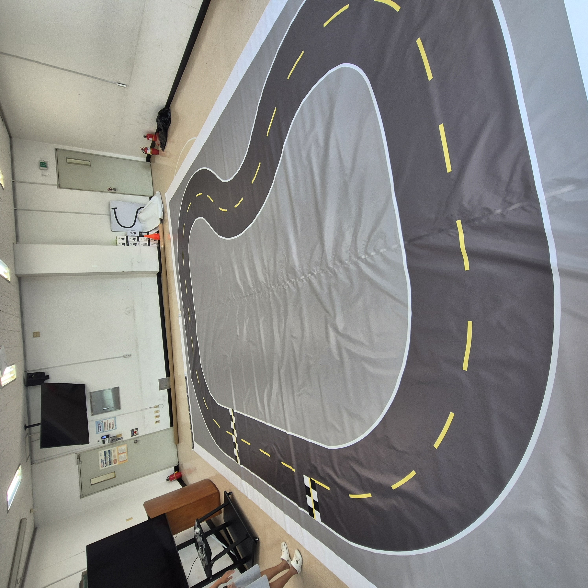
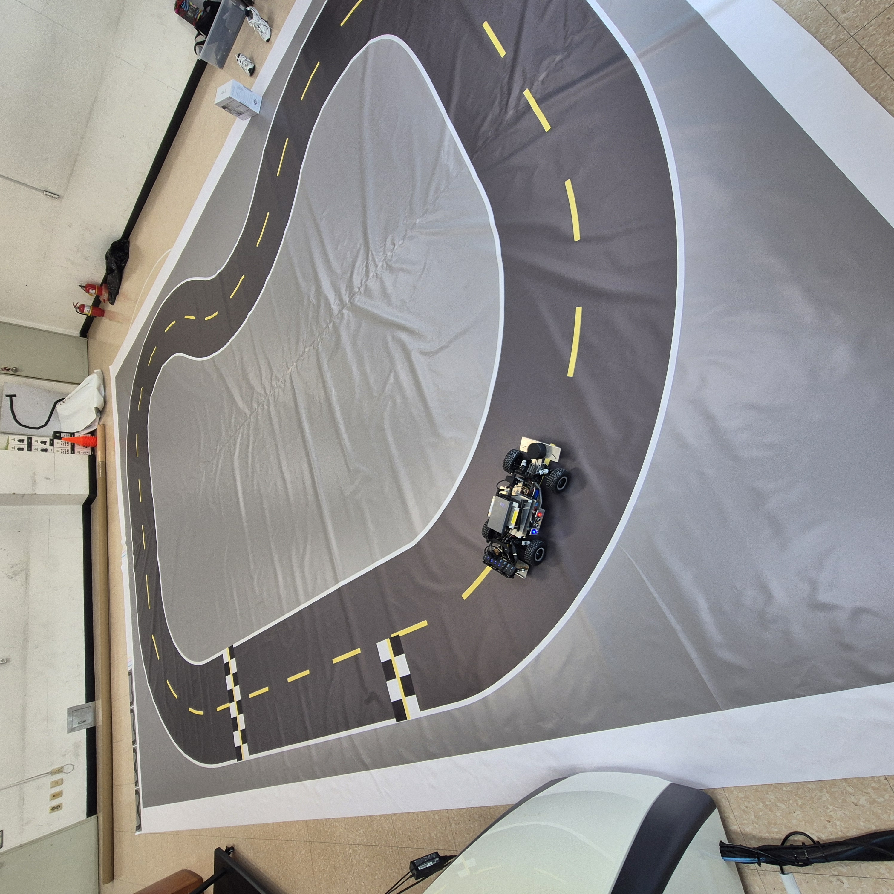
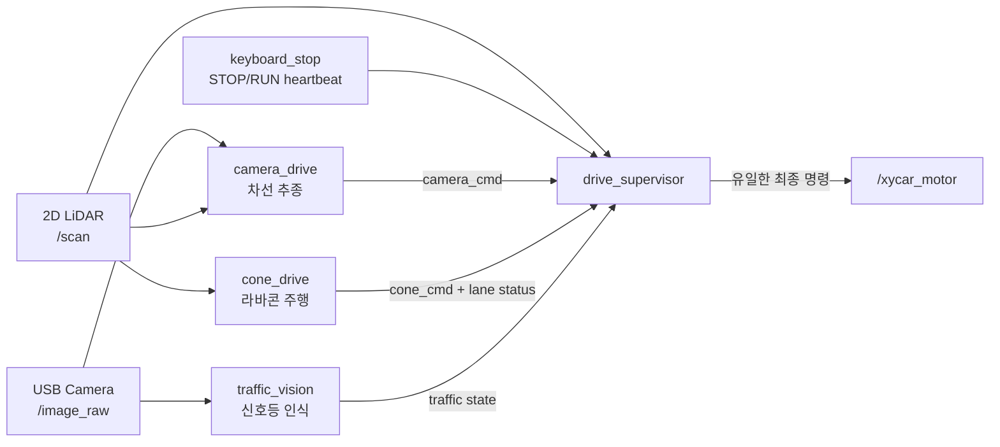
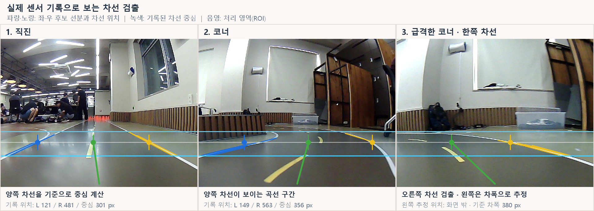
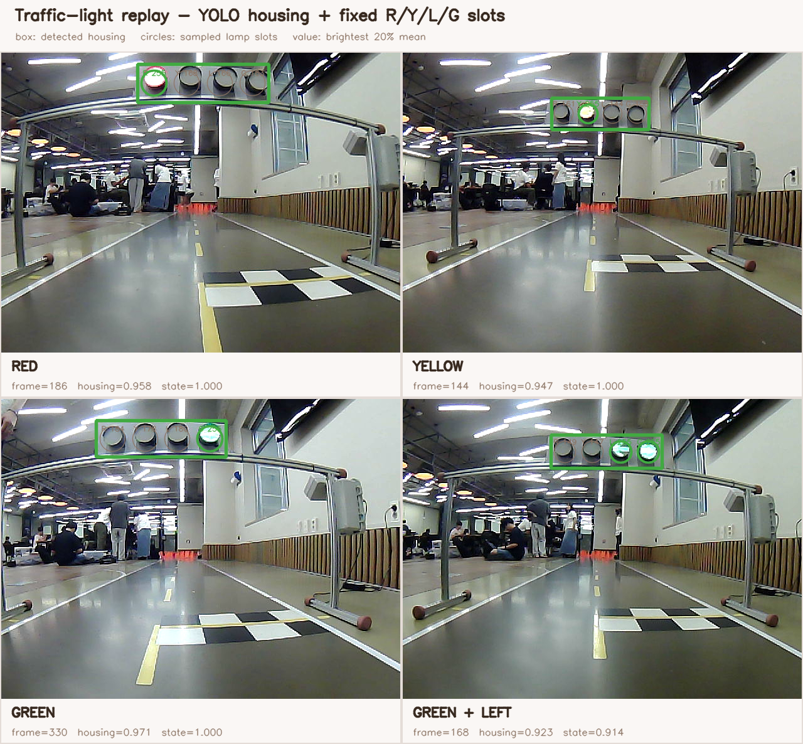
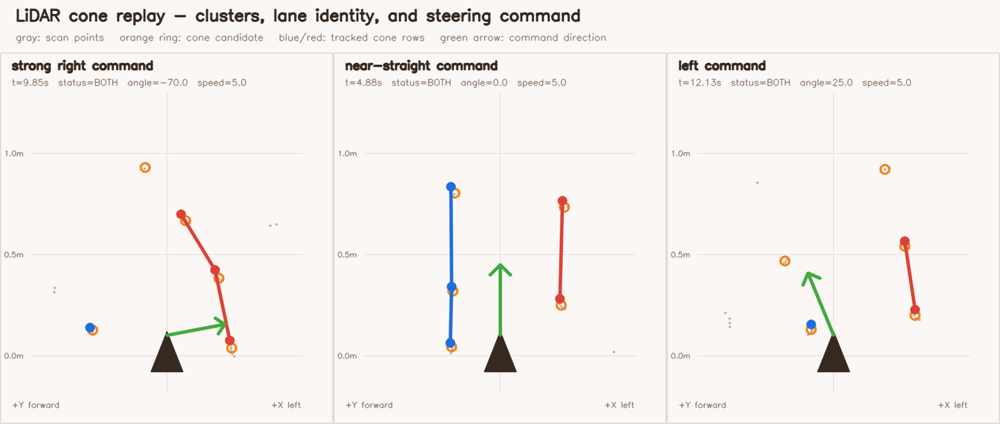

# 321고 | 2026 국민대학교 자율주행 경진대회

국민대 자율주행 경진대회 제9회 본선 미션을 수행하기 위해 제작한 자이카(Xycar Y) 기반 ROS 2 패키지입니다. 카메라 차선 추종과 신호등 인식, 2D LiDAR 라바콘 주행과 차량형 장애물 회피, 최종 모터 명령을 관리하는 안전 감독기를 하나의 실행 흐름으로 통합했습니다.

대회 결과와 팀 기여, 주요 알고리즘, 센서 기록 기반 인식 결과를 정리한 저장소입니다. 실제 대회 주행 영상은 [영상 자료](media/README.md)에 추후 추가합니다.

## 프로젝트 한눈에 보기

| 항목 | 내용 |
| --- | --- |
| 대회 | [제9회 국민대학교 자율주행 경진대회 - AI-엣지 챌린지](https://auto-contest.kookmin.ac.kr/), 2026-08-25 |
| 팀 | 321고 - 김재윤, 신현민, 박현명 |
| 개발 기간 | 2026-07-27 ~ 2026-08-24, 약 4주 |
| 대회 결과 | 6위, 146.02초 완주, 벌점 21초 |
| 플랫폼 | Xycar Y, Ubuntu 22.04, ROS 2 Humble |
| 입력 | 640×480 USB 카메라, 2D LiDAR, 키보드 안전 제어 |
| 출력 | 조향각·속도 명령 `/xycar_motor` |
| 핵심 기술 | OpenCV 차선 인식, YOLOv8n ONNX 신호등 외함 검출, 밝기 기반 4구 신호 분류, LiDAR 군집화·추적, 상태 기반 모드 전환, fail-safe supervisor |
| 구현 언어 | C++17, Python 3 |
| 패키지 | [`final_drive`](final_drive/final_drive/README.md) |

## 대회 결과

팀 **321고**는 본선 주행을 **146.02초로 완주해 6위**를 기록했습니다. 현장에서 기록한 벌점 합계는 21초입니다.

| 벌점 항목 | 횟수 | 벌점 |
| --- | ---: | ---: |
| 라바콘 접촉 | 2개 | 6초 |
| 주행 방해 차량 추돌 | 1회 | 10초 |
| 차선 이탈 후 차량 원위치 조치 | 1회 | 5초 |
| **합계** |  | **21초** |

대회 당일에는 별도 파라미터 변경 없이 [`final_drive.launch.py`](final_drive/final_drive/launch/final_drive.launch.py)의 설정으로 전체 시스템을 실행했습니다.

## 팀 구성과 협업

| 팀원 | 대표 담당 영역 |
| --- | --- |
| **김재윤** | LiDAR 라바콘 주행, 개별 코드 통합, 통합 후 문제 확인과 보완 |
| **신현민** | 신호등 데이터 라벨링·학습과 신호 식별, 연습용 트랙 제작 진행·주문 |
| **박현명** | 카메라 차선 주행과 고정 차량 및 방해 차량 추월 |

위 표는 각자의 주 담당 영역입니다. 실제 개발에서는 세 명이 각 파트의 발전 방향과 문제 해결 방법을 함께 토론했고, 차량 준비와 트랙 데이터 수집, rosbag 기록, 실제 주행 테스트도 공동으로 진행했습니다.

## 학교 연습용 축소 트랙

실제 대회장이 아닌 교내 연습을 위해 제작한 축소 트랙입니다. 차선 추종, 곡률 변화, 출발선 통과와 반복 주행을 빠르게 검증하는 데 사용했습니다. 상세 치수와 인쇄 원본은 [테스트 트랙 기록](docs/test-track.md)에서 확인할 수 있습니다.

<table>
  <tr>
    <td width="50%"></td>
    <td width="50%"></td>
  </tr>
  <tr>
    <td align="center">설치 완료된 교내 테스트 트랙</td>
    <td align="center">Xycar Y 주행 검증 장면</td>
  </tr>
</table>

## 대회 미션과 구현 연결

공식 경기는 녹색 신호 출발 후 차선을 지키며 3바퀴를 주행하고, 라바콘·고정 장애물·방해 차량을 처리한 뒤 결승선을 통과하는 방식입니다. 주행 시간과 벌점 시간을 합산하며 오전·오후 기록 중 더 좋은 성적을 사용합니다. 규정의 자세한 수치와 벌점은 [대회 규정 요약](docs/competition.md)을 참고하세요.

| 대회 미션 | 적용 기술 | 구현 상태 |
| --- | --- | --- |
| 4구 신호등 녹색 출발 | YOLO 외함 검출 → R/Y/L/G 고정 슬롯 밝기 분류 → 3프레임 녹색 확인 | 구현 |
| 차선 준수 주행 | 하단 ROI, Canny, 확률적 허프 변환, 동적 PD 조향, 곡률별 감속 | 구현 |
| 라바콘 구간 | LiDAR 군집·형상 검증, 시계열 추적, 좌·우 열 구성, 중앙 경로 추종 | 구현 |
| 고정 장애물·방해 차량 | 소형 차량형 군집 검출, 벽 반사 제거, 빈 차선 선택, 제동 후 회피 | 공통 회피 로직으로 구현 |
| 신호등 경로 선택 | `GREEN_LEFT` 상태까지 구분 | 좌회전 지름길 조향은 미구현, 직진 전략 |

## 시스템 구조



통합 런치에서는 두 주행 노드가 후보 명령을 만들고 `drive_supervisor`만 최종 모터 명령을 발행합니다. 감독기는 CAMERA↔CONE 모드 전환과 출력 완화뿐 아니라 다음 조건에서 속도 명령을 0으로 덮어씁니다.

- 키보드 STOP 또는 heartbeat 단절
- 빨강·노랑 신호 연속 확인
- 신호등·LiDAR·선택된 주행 명령의 timeout
- 초기 녹색 신호 미확인
- 장시간 차선 손실 또는 라바콘 추적 실패

상세 토픽, 임계값, 알고리즘 흐름은 [기술 상세](docs/technical-details.md)에 정리했습니다.

## 핵심 설계 포인트

### 1. 카메라 차선 추종

640×480 영상의 `y=300..379` 영역에서 에지와 선분을 추출합니다. 흰색 점수와 기울기로 좌·우 차선을 선택하고, 한쪽만 보일 때는 380 px의 기준 차폭으로 반대편을 추정합니다. 차선 중앙 오차와 변화량으로 조향하며, 곡률과 조향량이 커질수록 속도를 낮춥니다.

### 2. 신호등: 검출과 상태 분류의 분리

단일 클래스 YOLOv8n 모델은 4구 신호등 외함만 찾습니다. 검출 상자를 R/Y/L/G 네 슬롯으로 나눈 뒤 각 원형 영역의 밝은 상위 20% 픽셀을 측정해 빨강, 노랑, 녹색, 녹색+좌회전을 판정합니다. 색상만으로 직접 5개 상태를 학습했을 때의 혼동을 줄이고, 판단 과정을 설명할 수 있도록 만든 2단계 구조입니다.

### 3. LiDAR 라바콘 인식과 경로 생성

연속 거리점을 군집화한 뒤 크기·선형성·곡률·센서 방향성을 이용해 벽과 큰 원통 반사를 제거합니다. 두 스캔 이상 유지된 물체만 라바콘으로 확정하고, 25~35 cm 간격의 좌·우 열을 연결합니다. 양쪽 열의 중앙 또는 한쪽 열의 오프셋으로 기준 경로를 만들며, 차체와 가까운 라바콘이 있으면 조향 목표를 반대편으로 보정하고 감속합니다.

### 4. 차량형 장애물 회피

직선에서 실제 양쪽 차선이 2프레임 연속 보이고 정상 주행 속도가 확보된 경우에만 회피 진입을 허용합니다. LiDAR의 넓은 영역에서 먼저 긴 벽 반사를 제거한 뒤 좁은 전방 영역의 소형 군집을 2스캔 확인합니다. 0.5초 능동 제동 후 장애물이 없는 차선을 추종하고, 원래 장애물 쪽이 1.5초간 비면 정상 차선 추종으로 복귀합니다.

## ROS bag 기반 주행 인식 검증

주행 테스트에서 수집한 센서 기록과 분석 결과를 바탕으로 인식 과정을 시각화했습니다. 아래 이미지는 대표 장면을 보여 주며 전체 주행의 정확도나 성공률을 의미하지 않습니다.

### 차선 검출



왼쪽부터 직진, 양쪽 차선이 보이는 코너, 오른쪽 차선만 보이는 급격한 코너입니다. 카메라 영상과 가까운 시각의 `/final_drive/camera_lane_state`를 맞춰 차선 위치와 중심을 표시했습니다. 마지막 장면의 왼쪽 위치는 검출값이 아니라 380 px 기준 차폭으로 보완한 추정값입니다. 파란색·노란색 선은 ROI·Canny·Hough로 다시 찾은 후보이고, 녹색은 기록된 차선 중심입니다.

### 신호등 검출과 상태 분류



최종 `traffic_housing_v2_best.onnx`로 4구 신호등 외함을 찾고, R/Y/L/G 고정 슬롯의 밝기 상위 20% 평균으로 빨강·노랑·녹색·녹색+좌회전을 구분한 대표 결과입니다. 상자는 외함 검출 위치, 원은 각 신호등 슬롯의 측정 영역을 나타냅니다.

### LiDAR 라바콘 감지와 경로 구성



라바콘 분석 기록을 위에서 본 좌표계로 나타냈습니다. 회색은 LiDAR 점군, 주황색 테두리는 라바콘 후보, 파란색·빨간색은 추적된 좌·우 열, 녹색 화살표는 기록된 조향 명령의 방향입니다.

## 빌드와 실행

저장소의 `final_drive/final_drive/` 디렉터리를 자이카의 `~/xycar_ws/src/final_drive`에 배치합니다. ROS 2 Humble, `usb_cam`, `xycar_lidar`와 차량의 모터 구동 환경이 먼저 준비되어 있어야 합니다.

```bash
cd ~/xycar_ws
colcon build --symlink-install --packages-select final_drive
source install/setup.bash
ros2 launch final_drive final_drive.launch.py
```

메인 런치는 안전상 키보드 제어 노드의 STOP→RUN handshake를 요구합니다. 별도 터미널에서 다음을 실행하고 `SPACE`로 주행/정지를 전환합니다.

```bash
source ~/xycar_ws/install/setup.bash
ros2 run final_drive keyboard_stop
```

의존성, 진단 도구, 테스트 방법과 단독 실행 시 주의사항은 [패키지 사용 문서](final_drive/final_drive/README.md)를 참고하세요.

## 저장소 구성

```text
.
├── README.md                         # 포트폴리오 진입점
├── docs/
│   ├── competition.md               # 공식 경기 규정 요약
│   ├── technical-details.md         # 알고리즘·토픽·안전 설계
│   ├── test-track.md                # 교내 축소 트랙 기록
│   └── portfolio-checklist.md       # 추후 추가할 기록
├── media/
│   ├── README.md                    # 실제 대회 영상 추가 위치
│   └── rosbag-analysis/             # 차선·신호등·라바콘 시각화
├── test_track/                       # 트랙 PDF 원본과 현장 사진
├── final_drive/final_drive/          # ROS 2 패키지
├── 2026년-9회대회-경주진행방법-최종.pdf
└── 자이카 ROS2-미니PC-Y모델 사용설명서-2026-0704.pdf
```

## 원본 자료

- [대회 공식 웹사이트](https://auto-contest.kookmin.ac.kr/)
- [2026년 제9회 대회 경주 진행 방법·규정 PDF](<2026년-9회대회-경주진행방법-최종.pdf>)
- [Xycar ROS 2 미니PC Y모델 사용설명서 PDF](<자이카 ROS2-미니PC-Y모델 사용설명서-2026-0704.pdf>)
- [축소 트랙 1:1 인쇄 PDF](test_track/track_small_1to1.pdf)
- [축소 트랙 치수도 PDF](test_track/track_small_dimensioned.pdf)
