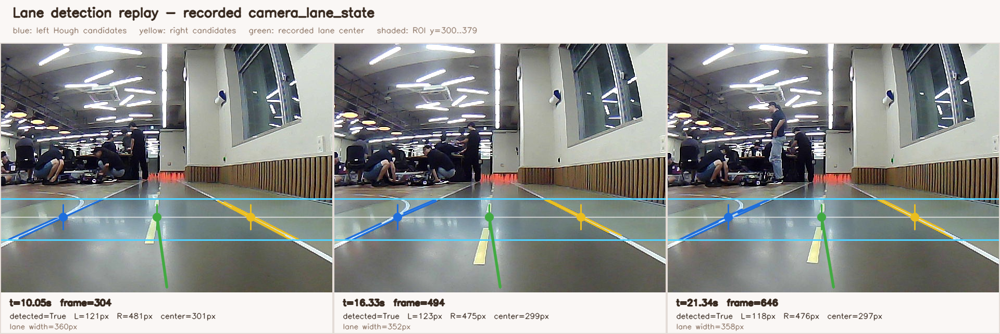
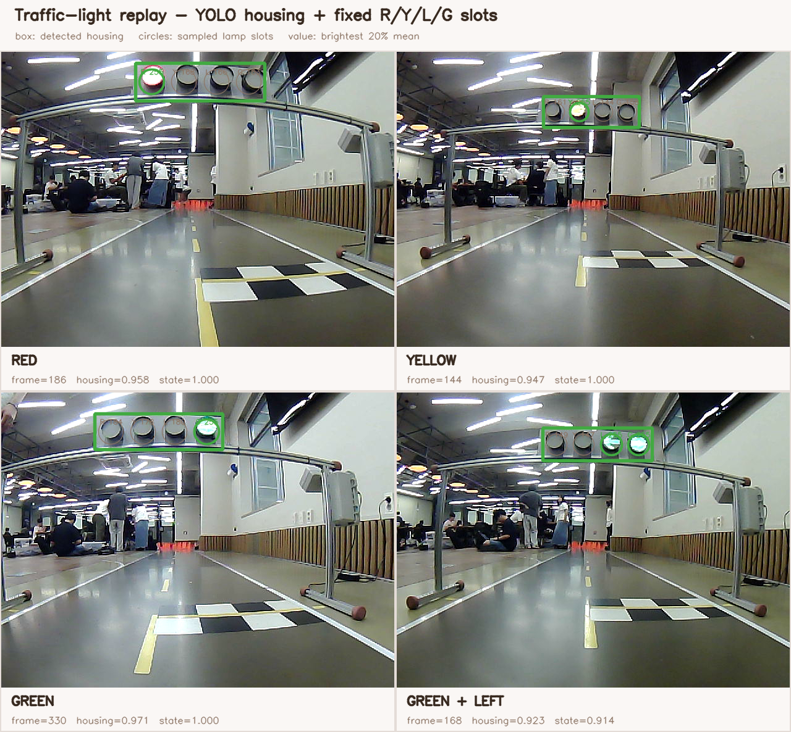
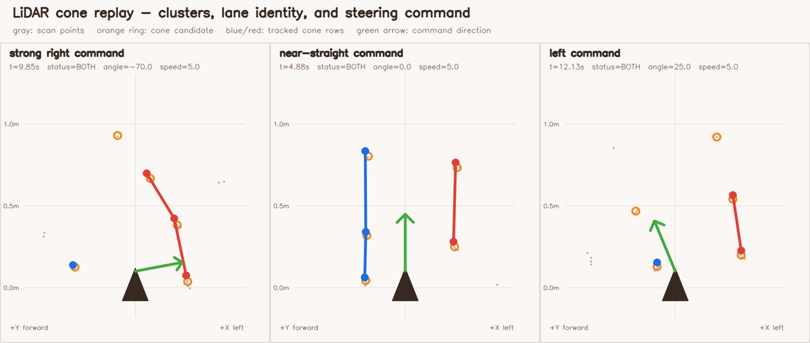
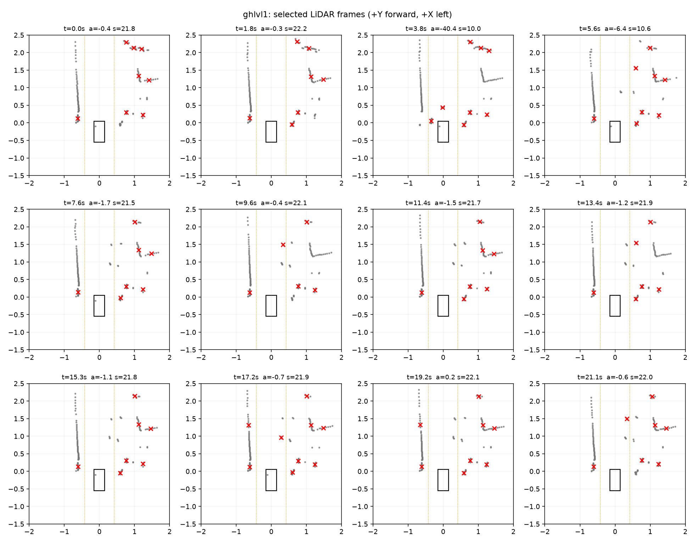
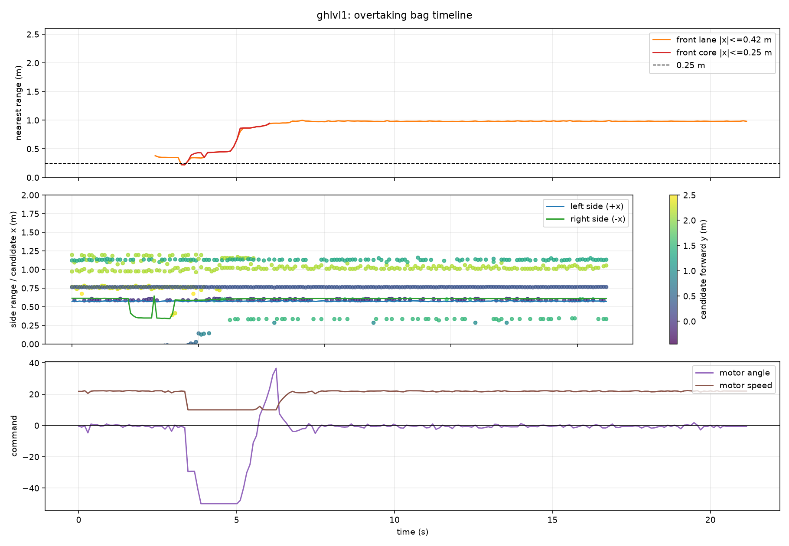

# ROS bag 기반 인식 결과

이 문서는 교내 연습 주행 중 기록한 ROS 2 bag을 오프라인으로 재생해 차선, 신호등, 라바콘과 차량형 장애물 처리 결과를 확인한 기록입니다. 아래 이미지는 실제 대회 당일 영상이나 공식 경기 성능 수치가 아니라 **학교에서 진행한 개발·검증 과정의 증거**입니다.

## 데이터 공개 범위

- 로컬 원본: SQLite 형식 ROS 2 bag 23개, 약 4.68 GiB
- 저장소 포함 파일: 대표 검출 이미지, 선정 프레임의 수치 [`summary.json`](../media/rosbag-analysis/summary.json), 재생성 스크립트 [`generate_rosbag_visuals.py`](../tools/generate_rosbag_visuals.py)
- 로컬 전용 파일: 원본 `.db3`, 추출 데이터셋과 전체 학습 결과

원본 중에는 [GitHub가 일반 Git 저장소에서 차단하는 100 MiB](https://docs.github.com/en/repositories/working-with-files/managing-large-files/about-large-files-on-github)보다 큰 파일이 다수 포함되어 있습니다. 동일 영상이 bag·학습 데이터셋·학습 결과에 중복으로 들어 있어 저장소에는 원본 폴더를 올리지 않고 `.gitignore`로 제외했습니다. 추후 원본을 공유해야 한다면 필요한 구간만 익명화해 Git LFS나 별도 스토리지에 보관하는 편이 적합합니다.

## 1. 차선 검출



| 항목 | 값 |
| --- | --- |
| 입력 bag | `rosbag/run_03_slow/run_03_slow_0.db3` |
| 카메라 토픽 | `/image_raw/compressed` |
| 판정 토픽 | `/final_drive/camera_lane_state` |
| 표시 프레임 | 304, 494, 646 |
| 판정 배열 | `[detected, left_x, right_x, center_x, lane_width]` |

영상 위 후보선은 실제 `camera_drive_node.cpp`와 같은 `y=300..379` ROI, Gaussian 5×5, Canny 60/80, 확률적 Hough 조건으로 다시 추출했습니다. 원형 표식과 녹색 목표선에는 영상과 가장 가까운 시각에 기록된 `/final_drive/camera_lane_state` 값을 사용했습니다. 세 프레임의 기록 중심은 각각 301 px, 299 px, 297 px이며 영상 중심 320 px을 기준으로 조향 오차를 계산합니다.

## 2. 신호등 검출과 상태 분류



`traffic_housing_v2_best.onnx`가 신호등 외함을 검출하고, 검출 상자를 R/Y/L/G 네 슬롯으로 나눈 뒤 각 원형 샘플에서 밝은 상위 20% 픽셀 평균을 계산했습니다. 각 상태별 `_03` bag을 6프레임 간격으로 추론하고, 기대 상태로 판정된 프레임 중 외함·상태 신뢰도가 높은 대표 한 장을 골랐습니다.

| 상태 | 프레임 | 외함 신뢰도 | 상태 신뢰도 | R / Y / L / G 밝기 |
| --- | ---: | ---: | ---: | --- |
| 빨강 | 186 | 0.958 | 1.000 | 255 / 168 / 166 / 163 |
| 노랑 | 144 | 0.947 | 1.000 | 161 / 255 / 144 / 158 |
| 녹색 | 330 | 0.971 | 1.000 | 184 / 178 / 180 / 255 |
| 녹색+좌회전 | 168 | 0.923 | 0.914 | 149 / 147 / 255 / 255 |

이 표는 선택된 대표 프레임의 내부 판정값이며 전체 데이터셋 정확도를 의미하지 않습니다. 연속 주행에서는 단일 프레임 오판을 줄이기 위해 시간축 필터가 추가로 같은 상태의 반복 검출을 요구합니다.

## 3. LiDAR 라바콘 감지



LiDAR 점군을 거리 연속성으로 군집화하고, 크기·선형성·곡률 조건을 통과한 후보만 표시했습니다. 후보는 시계열 추적 후 차량 기준 좌·우 라바콘 열로 연결되며, 양쪽 열이 확인되면 `BOTH` 상태에서 중앙 경로를 생성합니다. 그림은 오프라인 재생 run 03에서 라바콘 5개와 양쪽 열이 확인된 우조향·직진·좌조향 대표 프레임입니다.

## 4. 차량형 장애물과 추월

<table>
  <tr>
    <td width="50%"></td>
    <td width="50%"></td>
  </tr>
</table>

`ghlvl1` 기록은 차량 전방·측면의 최근접 거리와 모터 조향·속도 명령을 함께 담고 있습니다. 대표 프레임에서는 점군과 차량 후보를, 타임라인에서는 약 0.25 m 근접 구간에 대응해 속도가 낮아지고 조향 명령이 크게 변한 구간을 확인할 수 있습니다.

## 재현 방법

원본 `로스백 데이터들` 폴더와 Python 3, NumPy, OpenCV가 있는 환경에서 저장소 루트 기준으로 실행합니다.

```powershell
python tools/generate_rosbag_visuals.py
```

다른 위치에 데이터를 보관했다면 `--data-root`로 지정할 수 있습니다.

```powershell
python tools/generate_rosbag_visuals.py --data-root "D:\rosbag-data"
```

스크립트는 최종 ONNX 모델과 저장된 토픽을 다시 읽어 `media/rosbag-analysis/`의 이미지와 수치 요약을 갱신합니다.
