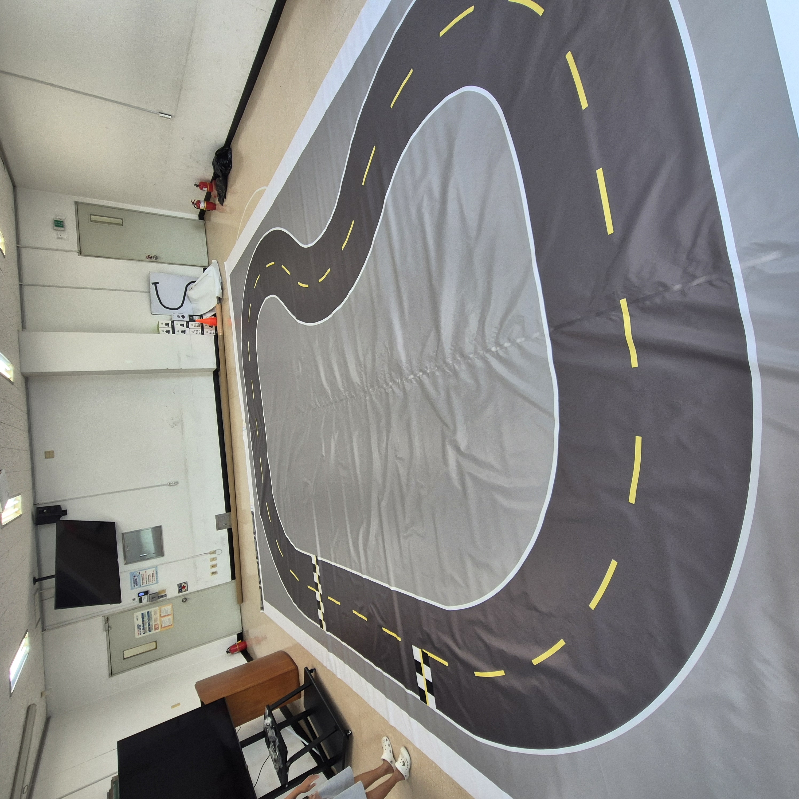
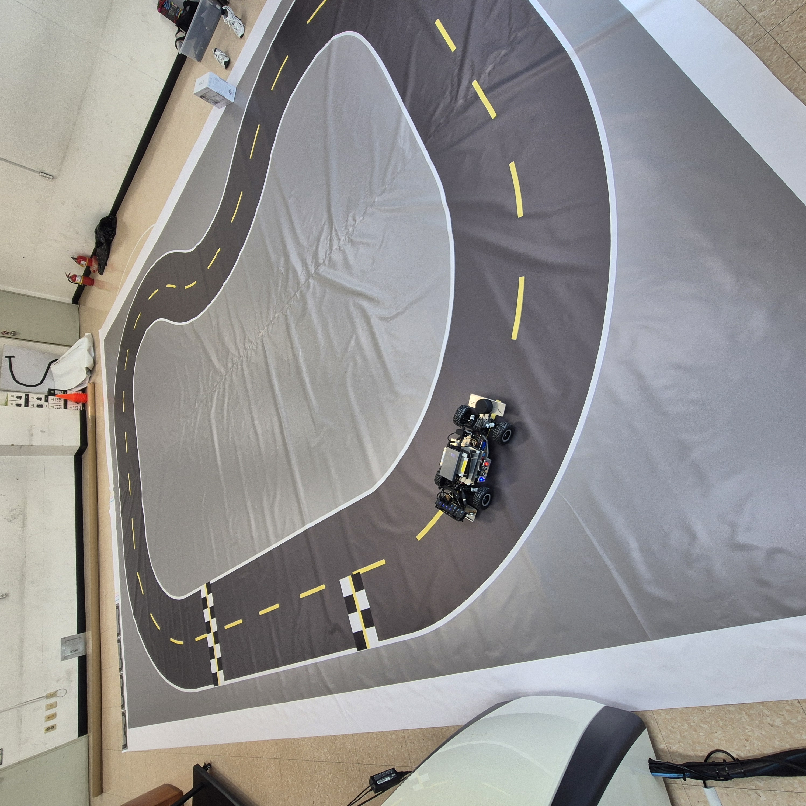

# 교내 축소 테스트 트랙

이 트랙은 실제 대회장의 복제본이 아니라 학교에서 반복 주행을 연습하기 위해 별도로 제작한 축소형 테스트 트랙입니다. 대회 결과 자료와 혼동되지 않도록 목적과 출처를 분리해 기록합니다.

## 치수

치수도에 표기된 값은 다음과 같습니다.

| 항목 | 값 |
| --- | ---: |
| 전체 폭 | 5,000 mm |
| 전체 높이 | 6,667 mm |
| 도로 폭 | 845 mm |
| 위쪽 안쪽 직선 | 1,460 mm |
| 왼쪽 안쪽 직선 | 2,730 mm |
| 아래쪽 안쪽 직선 | 920 mm |
| 코너 반지름 | R1,337 / R1,950 |
| 선 굵기 | 24 mm |
| 중앙선 길이 | 18.1 m |

## 제작 원본

- [트랙 1:1 인쇄 PDF](../test_track/track_small_1to1.pdf)
- [트랙 치수도 PDF](../test_track/track_small_dimensioned.pdf)

`track_small_1to1.pdf`는 실제 크기 출력용, `track_small_dimensioned.pdf`는 제작·검수용 치수 표기본입니다. 두 파일 모두 원본 해상도를 유지해 저장했습니다.

## 설치 사진

### 전체 설치 모습

### Xycar Y 주행 검증

## 이 트랙에서 확인할 수 있는 항목

- 카메라 ROI와 차선 중심 오차가 곡선에서도 안정적으로 계산되는지
- 직선과 곡선에서 속도 상한 전환이 과도한 진동 없이 이어지는지
- S자 구간에서 조향 방향이 바뀔 때 지연과 overshoot가 발생하는지
- 차선이 일부 가려지거나 한쪽만 보일 때 기준 차폭 추정이 유지되는지
- 출발선 주변에서 반복 주행과 수동 STOP/RUN 절차가 안전하게 동작하는지

라바콘, 고정 장애물, 방해 차량과 실제 대회 신호등 배치는 이 사진만으로 확인되지 않습니다. 해당 미션의 성능 증거는 실제 대회 영상 또는 rosbag을 별도로 추가해야 합니다.
